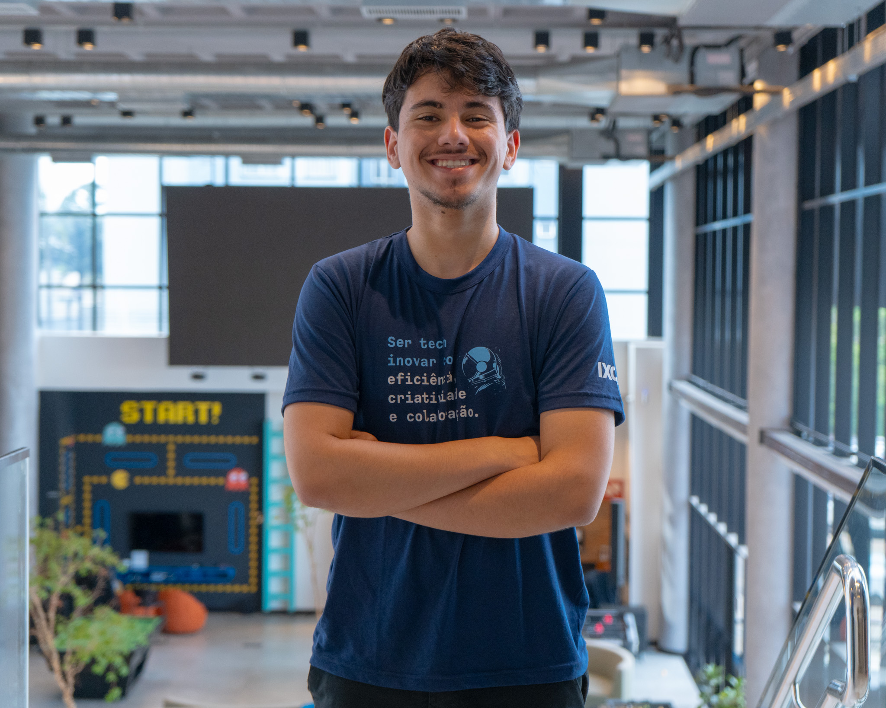

 Minha Jornada de Aprendizado — IXC Soft

Olá! Eu sou Juan Lopes 👋

Estagiário em Desenvolvimento na IXC Soft

Aprendendo, praticando e evoluindo um pouco todos os dias! 💻

Sobre o Projeto

Este repositório foi criado durante minha experiência como estagiário na IXC Soft, com o objetivo de registrar minha evolução e colocar em prática os conhecimentos adquiridos ao longo do estágio.

Até o momento, venho estudando tecnologias fundamentais para o desenvolvimento web e mobile, explorando conceitos de estruturação, estilização, programação e controle de versão.

Este projeto representa uma parte da minha jornada de aprendizado e continuará evoluindo conforme eu adquirir novos conhecimentos.

🛠️ Tecnologias e Ferramentas

📚 Conhecimentos adquiridos até o momento
Tecnologia	Aprendizado
🌐 HTML	Estruturação de páginas web e elementos HTML.
🎨 CSS	Estilização, cores, layouts e personalização de páginas.
⚡ JavaScript	Lógica de programação, variáveis, funções e fundamentos da linguagem.
🔀 Git	Controle de versão, commits e gerenciamento de alterações.
🐙 GitHub	Armazenamento e compartilhamento de projetos e códigos.

Algumas das documentações e plataformas utilizadas para aprendizado:

HTML — MDN Web Docs
CSS — MDN Web Docs
JavaScript — MDN Web Docs
Git — Documentação oficial
GitHub — Documentação

👨‍💻 Autor

Juan Lopes

Estagiário em Desenvolvimento
IXC Soft 💙

